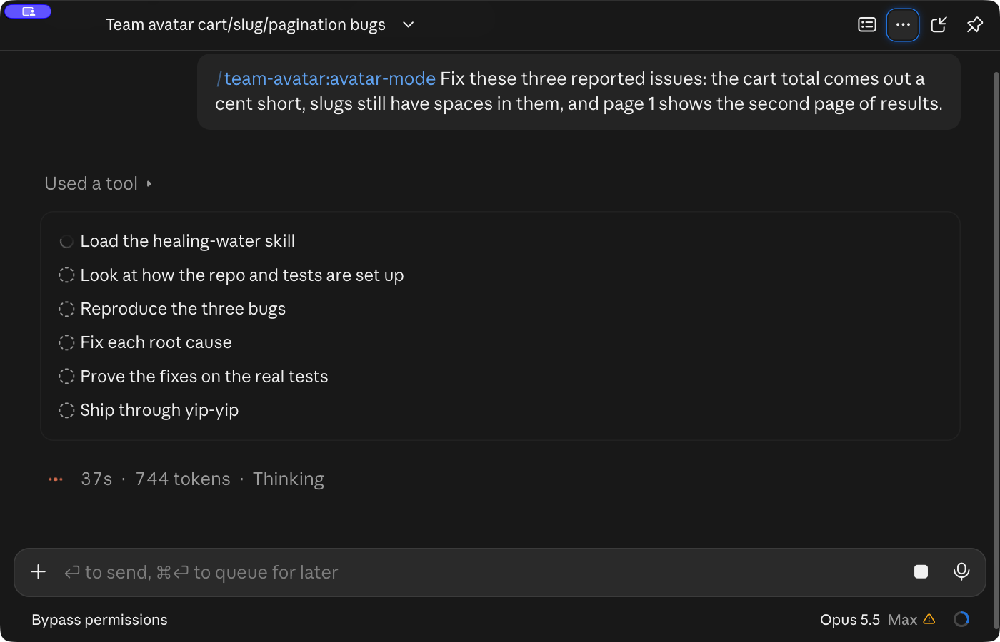
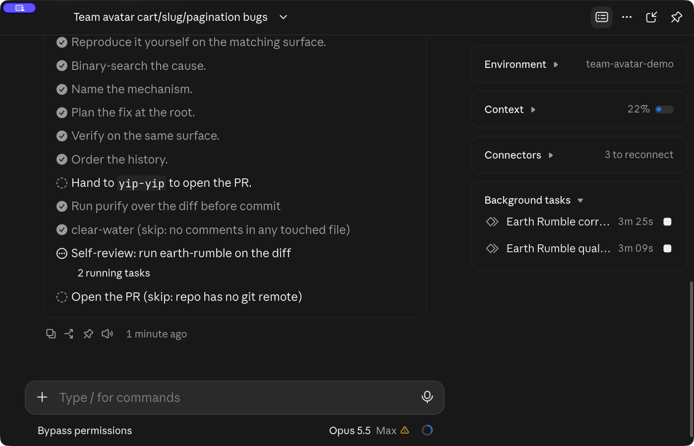
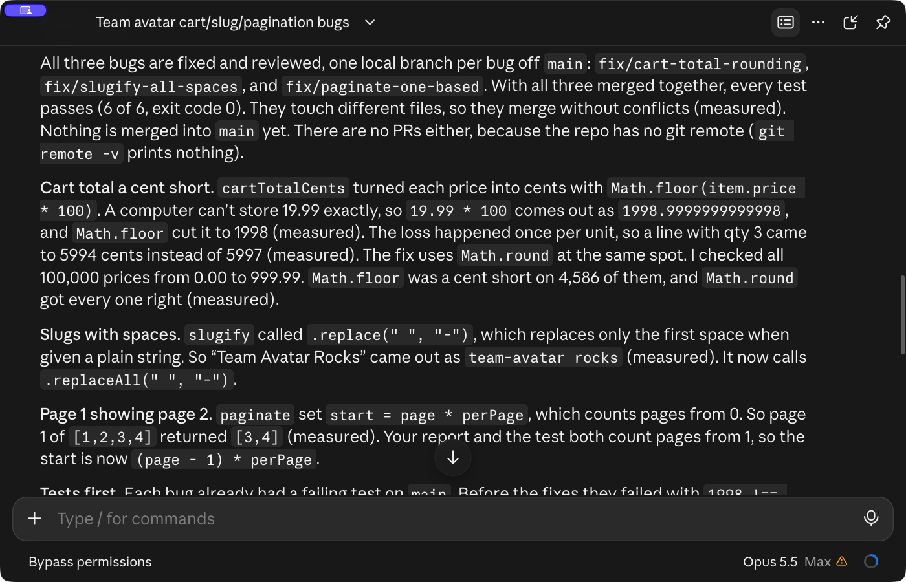
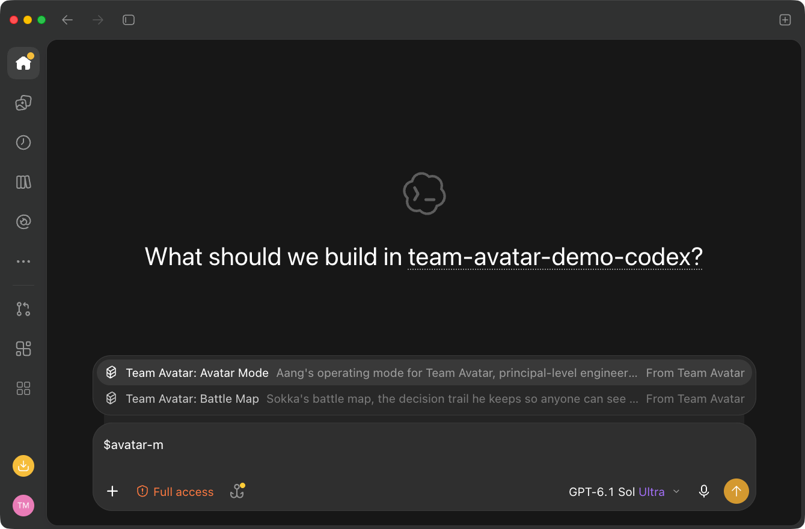
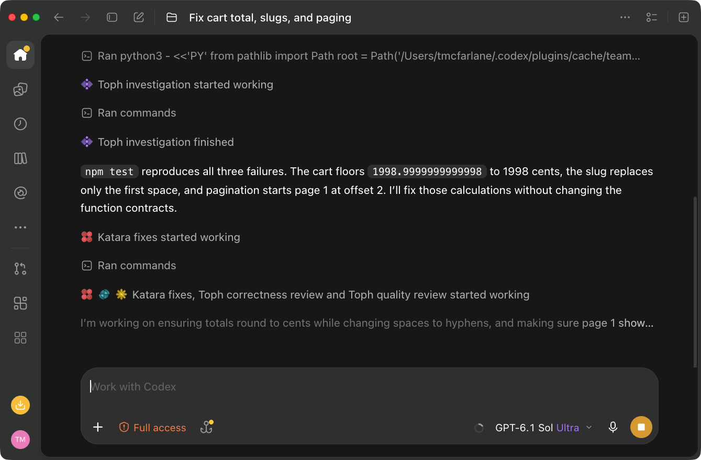
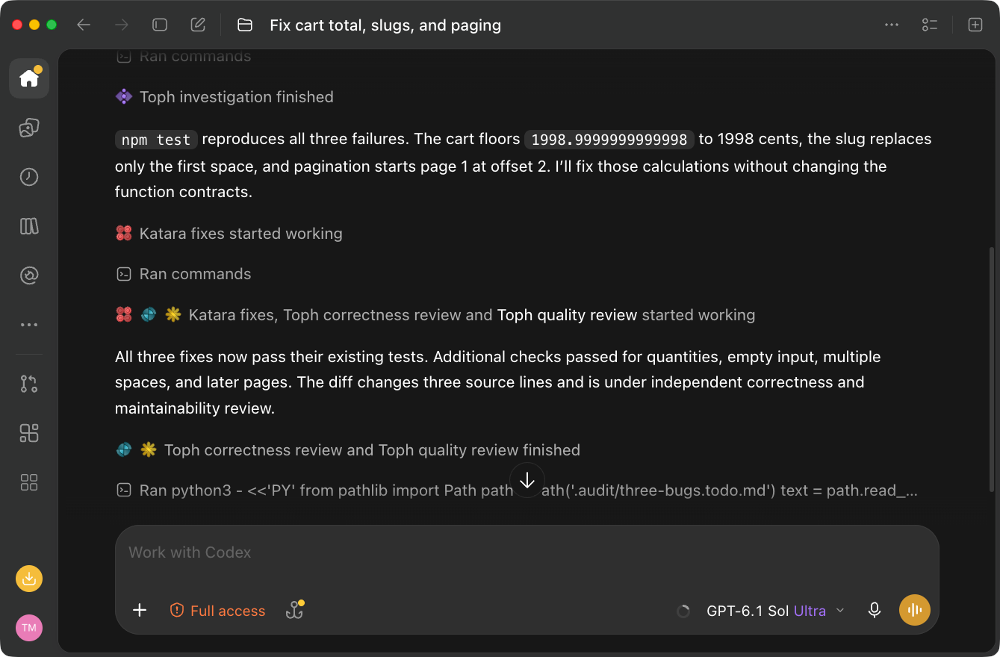

# Team Avatar in the desktop apps: screenshots

These are unedited window captures from the Claude desktop app and the Codex desktop app. Both apps got the demo repo from the [terminal screenshots](../release-v1.0.0/README.md), which has one failing test for each of three bugs. Both got the same one-line prompt:

```text
/team-avatar:avatar-mode Fix these three reported issues: the cart total comes out a cent short, slugs still have spaces in them, and page 1 shows the second page of results.
```

The prompt does not name a character, a workflow, or a number of agents. Avatar-mode chose those itself. In Codex, the `avatar-mode` part is the "Team Avatar: Avatar Mode" entry from the `$` skill picker.

## Claude Desktop

The session ran Opus 5.5 at Max effort in Bypass permissions mode. The session hooks of pstack and Team Avatar were both off, so only the slash command started avatar-mode. The Codex app typed the prompt into a new Claude Desktop session by driving the screen. The purple badge in the top-left corner comes from that screen control.

Avatar-mode loaded `healing-water` and `push-and-pull`, fixed each bug against its failing test, and committed the fixes on one local branch per bug. It then ran `earth-rumble`, which sent two Toph agents on Opus, one for correctness and one for code quality. They ran at the same time for about seven minutes, and their findings led to stronger tests. `yip-yip` skipped the pull request because the demo repo has no git remote. With the three branches applied together, 6 of 6 tests pass. The session ended by asking whether to merge the branches.







## Codex

The session ran GPT-6.1 Sol at Ultra with Full access. Team Avatar's Codex session hook was on. pstack's session hook was also on during this run, so the activity log has a line about pstack checks that these frames do not show. Claude typed the prompt by driving the Codex app.

Avatar-mode sent a Toph agent to investigate (28 seconds), then a Katara agent to fix the three lines (52 seconds). After Katara finished, it started a Toph correctness review and a Toph quality review, which ran at the same time for about 13 seconds. The agents ran GPT-6.1 Sol at medium effort. The run took 3 minutes 55 seconds and ended with 3 of 3 tests passing and nothing committed.

Codex lists Katara on the same line as the two reviews. That line groups events, and Katara had finished 25 seconds before the second frame was taken.







## How they were made

A script saved the app's own window with `screencapture -l <window-id>` every half second while each run worked. It never captured the main Claude window, whose sidebar lists other chats. The shots are recorded frames or stills of the finished thread, picked by hand and not edited. Their metadata was removed.

The Codex run was on October 24, 2026. The Claude Desktop run was on October 25, 2026. Earlier runs with a longer prompt, or with a Claude session started by another agent, are not shown.
