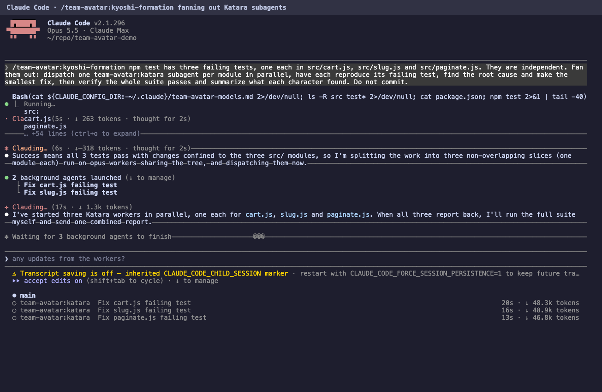
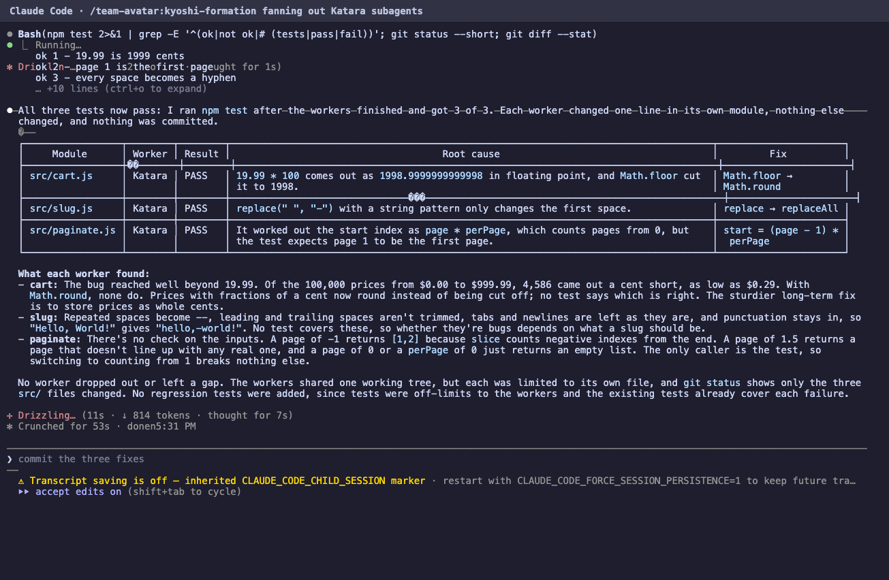
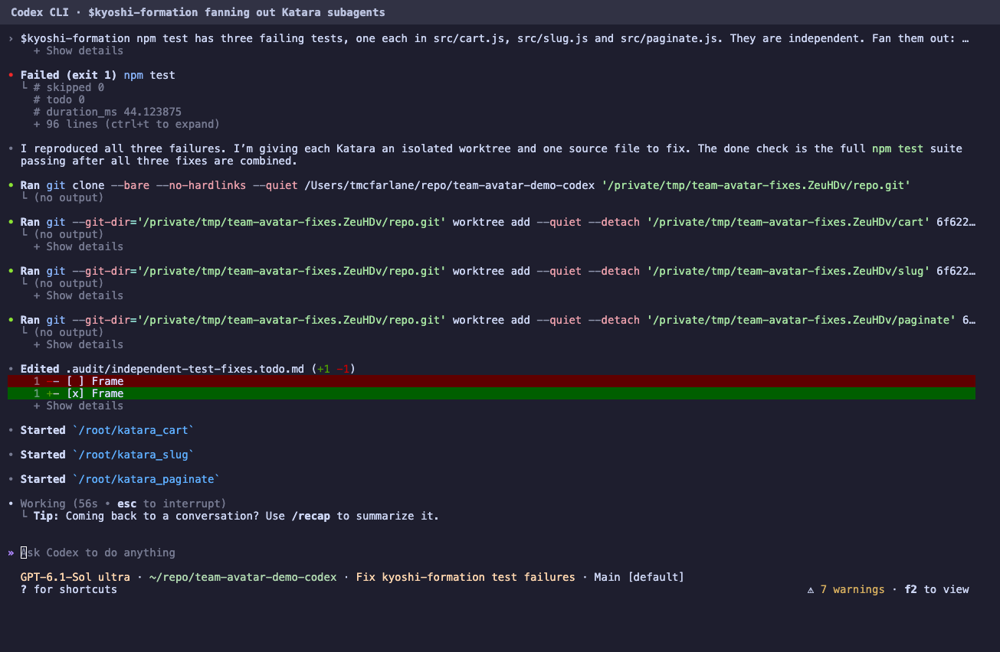
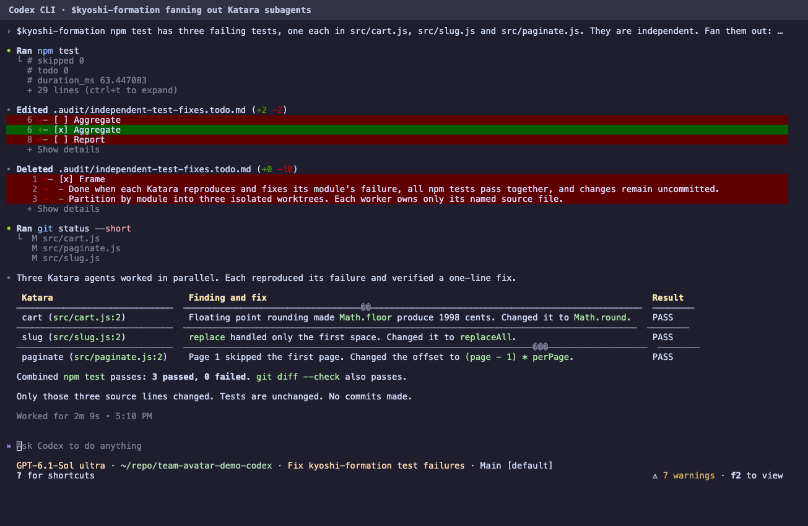

# Team Avatar v1.0.0: screenshots

These are real terminal sessions, not mockups. Each tool got the same small Node repo with three independent bugs and one failing test per bug:

| File | Bug |
|------|-----|
| `src/cart.js` | `Math.floor` turns $19.99 into 1998 cents |
| `src/slug.js` | `replace(" ", "-")` only replaces the first space |
| `src/paginate.js` | page 1 skips the first page |

Each tool got one prompt that asked for one Katara per module in parallel ([Claude prompt](recordings/demo-prompt.txt), [Codex prompt](recordings/codex-prompt.txt)). Neither run was edited or retried after it started.

## Claude Code

Plain Claude Code with only Team Avatar loaded (`--setting-sources project,local --plugin-dir plugins/team-avatar`). The agent panel at the bottom shows three `team-avatar:katara` agents running at once. The whole run took 53 seconds and ended with 3 of 3 tests passing and only the three source files changed.





## Codex

Codex with the installed `team-avatar` plugin. It reads `kyoshi-formation`, makes one git worktree per module, and starts `katara_cart`, `katara_slug` and `katara_paginate`. The session log has three child rollouts that point back at the parent thread. The run took 2 minutes 9 seconds and ended with 3 passed, 0 failed.





## How they were made

[`recordings/record.py`](recordings/record.py) runs each CLI in a real pseudo terminal at 150 by 46 and saves every byte of output with a timestamp. It answers the first-run dialogs (trust this folder, skip external imports, keep the current permission mode) and nothing else. [`recordings/render.mjs`](recordings/render.mjs) replays the bytes into xterm.js in headless Chrome and screenshots a chosen second. The raw recordings are in this folder, so any other frame can be rendered with:

```bash
node docs/evidence/release-v1.0.0/recordings/render.mjs docs/evidence/release-v1.0.0/recordings/claude-demo.json frame.png 20 "Claude Code"
```

Replay can leave small drawing artifacts where the live UI redrew a spinner line, such as stray strike-through lines. The text is what the CLI printed.
